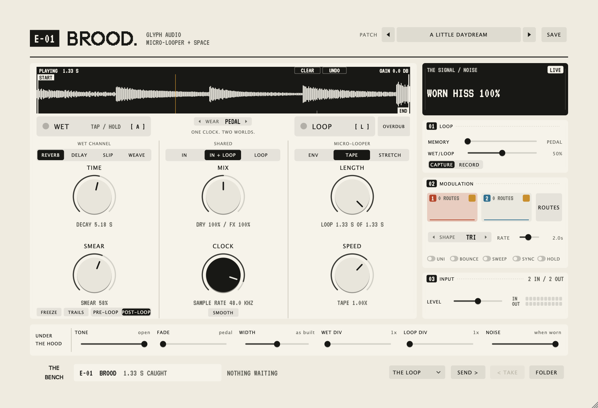

# Brood

A stereo micro-looper and spatial effect from Glyph Audio, as a plug-in for macOS (VST3,
AU and standalone) and as a browser version that runs the same DSP.



Brood is inspired by a pedal. It is an independent approximation of that pedal's
published behaviour, not its firmware and not a bit-exact emulation, and it hasn't been
calibrated against the hardware. It is not affiliated with or endorsed by Chase Bliss.

## Features

- **Two channels on one clock.** A wet channel (REVERB, DELAY, SLIP or WEAVE) and a
  micro-looper (ENV, TAPE or STRETCH) share a CLOCK that sets the engine's own sample
  rate, so slowing it darkens and lengthens everything together.
- **Always listening.** Tap the looper to catch the last few seconds, hold to overdub
  or record a new loop. Keep up to 30 s, and trim the take with START and END markers on
  the waveform.
- **Routing:** the wet side hears the input, the loop, or both, and runs before or after
  the looper. FREEZE holds the wet side ringing on its own.
- **Two modulation sources** with their own rate and shape, routed by dragging onto any
  knob.
- **Tempo sync** for the wet side, ENV and the modulation rate.
- **MIDI CC control** laid out like the pedal's, so a controller set up for it works.
- **Presets and the Bench:** factory presets and a preset browser, and the Bench, which
  passes loops to and from other Glyph Audio plug-ins.
- **Loops are saved with your project**, so a reopened session plays what you heard.

Every control is described in the [manual](docs/MANUAL.md).

## Status

Brood is in active development. The plug-in is developed and tested in Ableton Live 12
on macOS; other hosts and platforms are untested.

## Install

Download `Brood-<version>-macOS.pkg` from the
[latest release](https://github.com/Jackherz/Brood/releases/latest). It works on
Apple Silicon and Intel Macs, and installs the VST3, the Audio Unit and the standalone
app. It's free, and not notarised by Apple, so macOS asks you to allow it once:

1. Open the package. macOS says it can't verify it: click **Done**.
2. Open **System Settings > Privacy & Security**, scroll to *Security*, and click
   **Open Anyway** beside the message about Brood. Confirm with your password.
3. The installer opens. Install, then restart your DAW and rescan its plug-ins.

To build it yourself instead, see [INSTALL.md](INSTALL.md).

## Browser version

Needs Node.js 20 or newer.

```sh
npm ci
npm run dev
```

Open the URL Vite prints, choose DEMO, a FILE or LIVE IN, and press START AUDIO. Audio
stays in your browser. Use headphones with live input.

## Documentation

- [INSTALL.md](INSTALL.md): installing and building on macOS, and what to do if your DAW can't see it
- [docs/MANUAL.md](docs/MANUAL.md): every control, the MIDI map, and how the sound is made
- [docs/DEVELOPMENT.md](docs/DEVELOPMENT.md): building by hand, tests, repository layout
- [ROADMAP.md](ROADMAP.md): what's next, and what is deliberately left out

## Part of Glyph Audio

Brood shares its panel kit, [glyph-audio-kit](https://github.com/Jackherz/glyph-audio-kit),
with [Silt](https://github.com/Jackherz/silt), a granular sampler. The Bench passes audio
between them.

## Licence and credits

Brood's code is licensed under the GNU GPL v3 ([LICENSE](LICENSE)). It began from
[MoodEmu](https://github.com/MaxTeicheira/Cba-guitar-pedal-), also GPLv3; see
[THIRD_PARTY_NOTICES.md](THIRD_PARTY_NOTICES.md). The native build uses
[JUCE](https://juce.com) 8 under its AGPLv3 licence, and the fonts are under the SIL Open
Font License. Brood does not include or use any Chase Bliss firmware.

If Brood is ever sold, it stays open source under GPLv3; the reasoning is in
[docs/OPEN-SOURCE.md](docs/OPEN-SOURCE.md).
